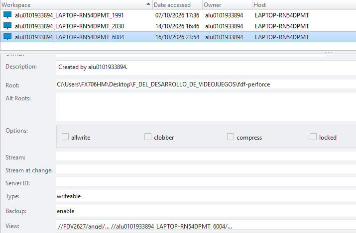
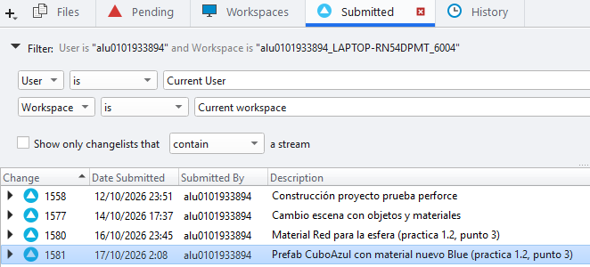
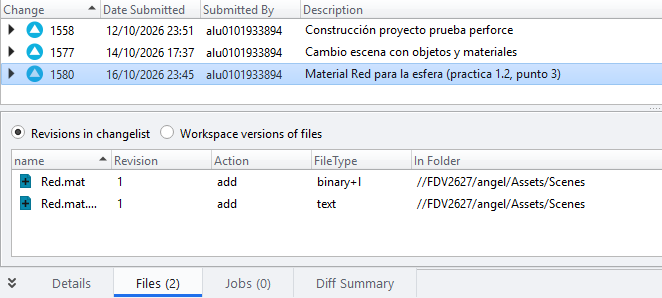
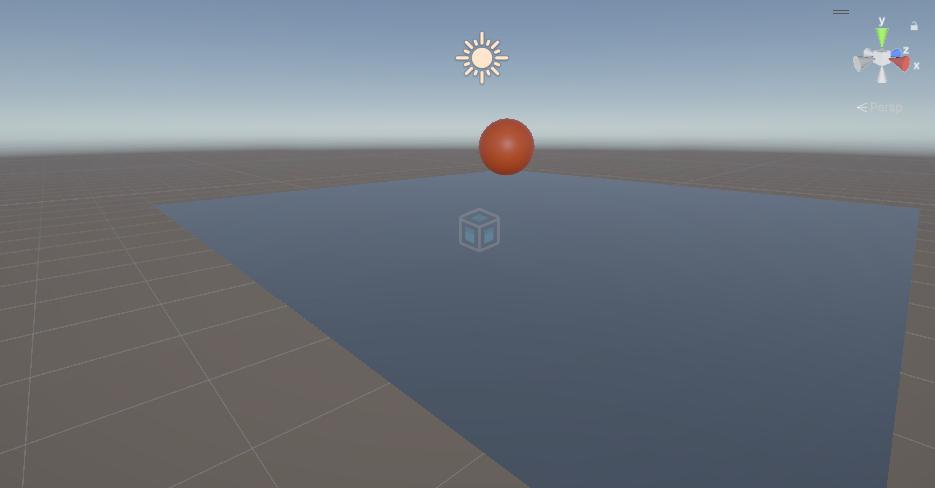
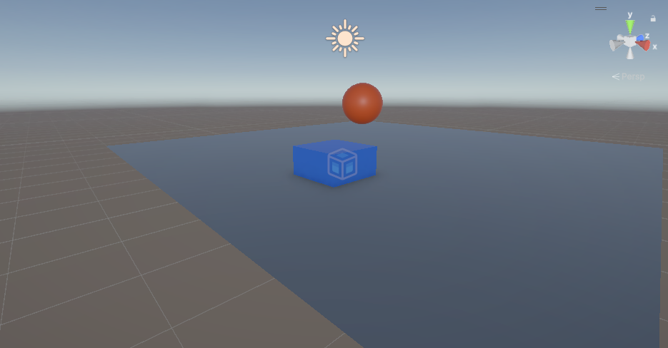
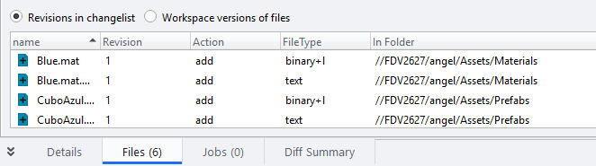

# Práctica 1.2 · Unity con Perforce

**Fundamentos del Desarrollo de Videojuegos** · Máster Universitario en Desarrollo de Videojuegos · Universidad de La Laguna · Curso 2026-27
**Autor:** Ángel Gonjar Verdejo

## Objetivo

Experimentar el control de versiones de un proyecto Unity con Perforce.

## 1. Conexión al depósito

Se estableció la conexión con el servidor Perforce de la ULL (`ssl:mudv-vcs.iaas.ull.es:1666`) desde el cliente P4V, con el usuario de la universidad. El proyecto se aloja en el depósito del curso 2026-27, `FDV2627` (figura 1).

## 2. Workspace y proyecto en el depósito

Se creó un workspace local asociado a la carpeta `angel/` del depósito, con el mapeo `//FDV2627/angel/...` (figura 2).

En esa carpeta se agregó el proyecto Unity `fdf-perforce`: las carpetas `Assets`, `Packages` y `ProjectSettings`, junto con el fichero `.p4ignore` de Unity, que excluye del control de versiones los ficheros que genera el editor. Los ficheros se marcaron para añadir y se enviaron al servidor en el changelist 1558 (figura 3).

## 3. Modificación del proyecto

Se activó la integración de Perforce en Unity (*Project Settings → Version Control*), de modo que el propio editor gestiona la extracción (*checkout*) de los ficheros que se modifican.

Se agregó al proyecto un objeto nuevo, el prefab `CuboAzul`, con un material nuevo, *Blue*, y se actualizó el depósito con el changelist 1581 (figuras 6 y 7). Además, se asignó a la esfera de la escena el material *Red* (changelists 1577 y 1580, figuras 4 y 5).

## Capturas del proceso

*Figura 1. Depósito FDV2627 en P4V, con el proyecto en la carpeta angel.*

*Figura 2. Workspace del proyecto: raíz local y mapeo del depósito.*

*Figura 3. Changelists enviados al depósito.*

*Figura 4. Contenido del changelist 1580.*

*Figura 5. Escena con la esfera y el material Red.*

*Figura 6. El objeto nuevo, CuboAzul, con el material Blue.*

*Figura 7. Contenido del changelist 1581: el prefab y el material nuevos.*

## Herramientas

Unity 6 (URP) · Perforce Helix Core · P4V

## Referencias

- Guion de la práctica y material de la asignatura (campus virtual de la ULL).
