# Práctica 1.3 · Control de versiones de Unity

**Fundamentos del Desarrollo de Videojuegos** · Máster Universitario en Desarrollo de Videojuegos · Universidad de La Laguna · Curso 2026-27
**Autor:** Ángel Gonjar Verdejo

## Objetivo

Experimentar el control de versiones con Unity, usando Unity Version Control (UVCS), el sistema de control de versiones de Unity, desde el propio editor.

## 1. Proyecto Unity con control de versiones

Se creó el proyecto `UnityVersion` con Unity 6000.5.11f1 y la plantilla *Universal 3D* (`com.unity.template.urp-blank`), basada en URP (*Universal Render Pipeline*). El proyecto usa Unity Version Control como sistema de control de versiones del editor (*Project Settings → Version Control*, figura 1).

El proyecto se aloja en el repositorio `My project/UnityVersion` de la nube de Unity Version Control, en la organización `agv114`, y se trabaja en el workspace local `My project-UnityVersion`. El repositorio numera cada registro de cambios como un *changeset*. El 14 de octubre de 2026 se creó la rama principal, `/main` (changeset 0), y se registró la primera versión del proyecto (changeset 1), que incluye las carpetas `Assets`, `Packages` y `ProjectSettings` y el fichero `ignore.conf`, que excluye del control de versiones las carpetas que crea el editor, como `Library`, `Temp` y `Logs` (figura 2).

## 2. Esfera roja y plano azul

Se creó la escena `Practica1_3` y se le añadieron dos objetos 3D, cada uno con un material nuevo de `Assets/Materials`: una esfera con el material *Red* y un plano con el material *Blue* (figura 3).

Tras añadir cada objeto se guardó la escena, y el cambio se registró en el repositorio con su propio *check-in* (envío de los cambios al servidor) en la rama `/main`: la esfera en el changeset 10 y el plano en el changeset 11, el 28 de octubre de 2026 (figura 4). Cada check-in incluye la escena y el material nuevo, con su color.

## 3. Cilindro verde

Se añadió a la escena un objeto nuevo, un cilindro con el material *Green* (figura 5). Se guardó la escena y el cambio se registró en `/main` en el changeset 12, el 28 de octubre de 2026 (figura 6).

## 4. Cápsula con textura en una rama nueva

Se creó la rama `/main/capsula-textura`, hija de `/main` a partir del changeset 12, el del cilindro, y se cambió el workspace a la rama nueva (figura 7).

En esa rama se añadió a la escena una cápsula con el material *Capsula*, cuya textura base (*Base Map*) es la imagen `URP.png` de la plantilla del proyecto (`Assets/TutorialInfo/Icons/URP.png`, figura 8). El cambio se registró en la rama nueva en el changeset 13, el 28 de octubre de 2026 (figuras 9 y 10).

La cápsula solo existe en la rama nueva: con el workspace de nuevo en `/main`, la escena muestra la esfera, el plano y el cilindro, sin la cápsula, y la carpeta `Assets/Materials` no tiene el material *Capsula* (figura 11). La rama no se ha fusionado con `/main`.

## Capturas del proceso

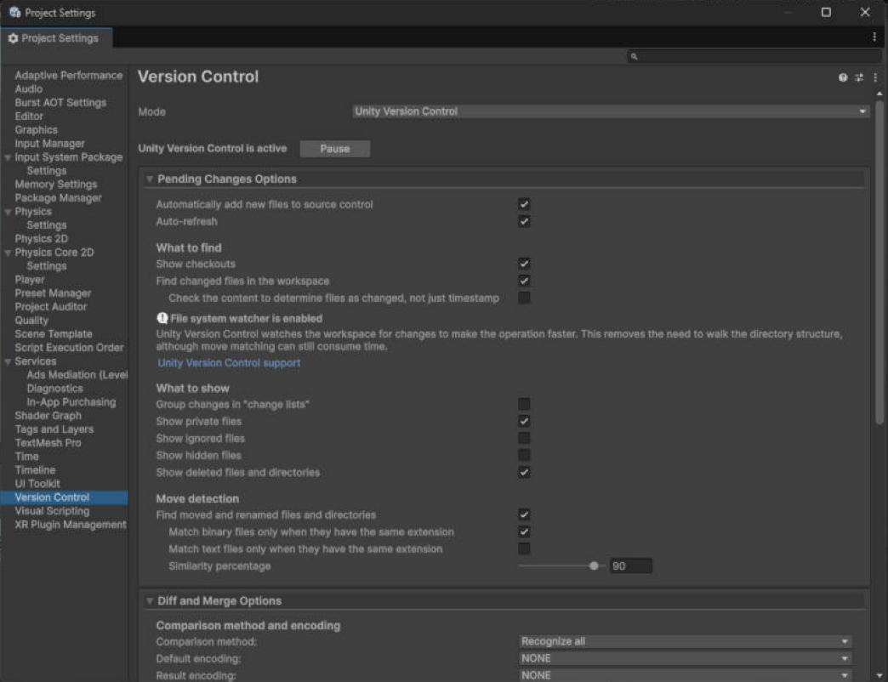

*Figura 1. Unity Version Control como sistema de control de versiones del proyecto.*

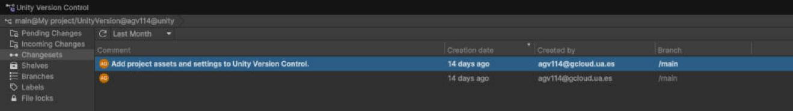

*Figura 2. Changesets iniciales del repositorio en la rama /main.*

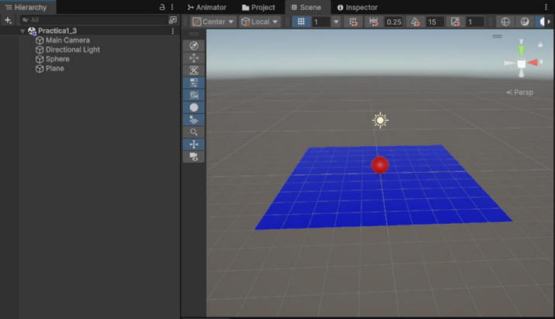

*Figura 3. Escena con la esfera (material Red) y el plano (material Blue).*

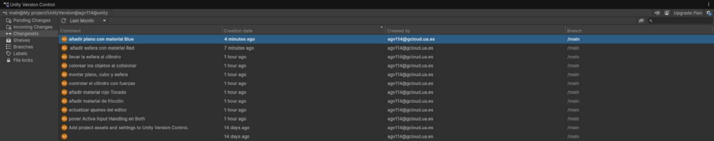

*Figura 4. Check-ins de la esfera y del plano en /main.*

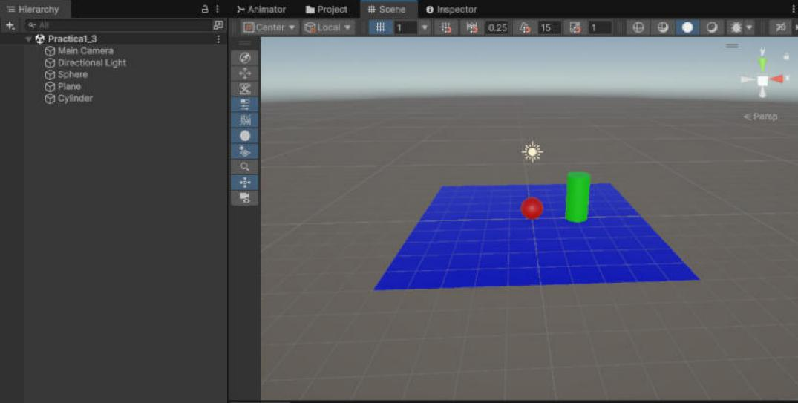

*Figura 5. El objeto nuevo: un cilindro con el material Green.*

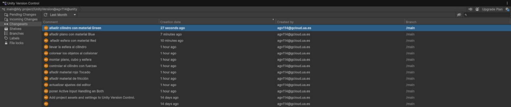

*Figura 6. Check-in del cilindro en /main y sus ficheros.*

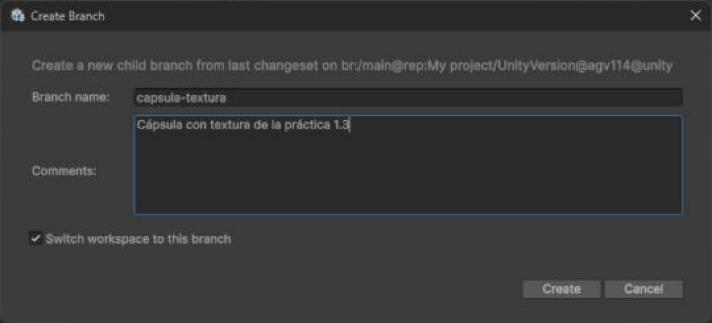

*Figura 7. Creación de la rama /main/capsula-textura.*

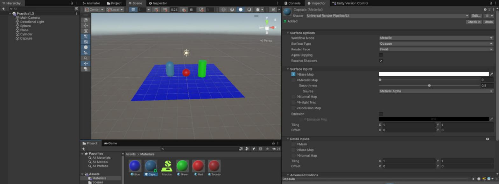

*Figura 8. Cápsula con el material Capsula, que usa la textura URP.*

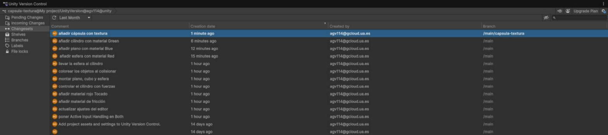

*Figura 9. Check-in de la cápsula en la rama /main/capsula-textura.*

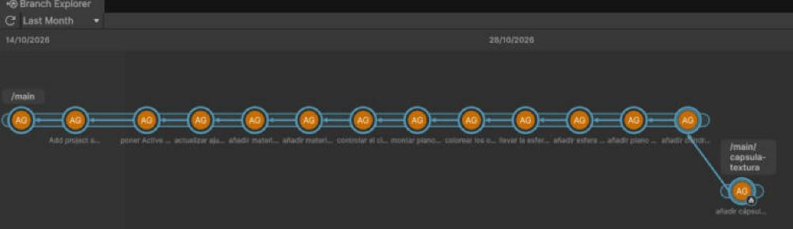

*Figura 10. Branch Explorer: la rama capsula-textura sale de /main.*

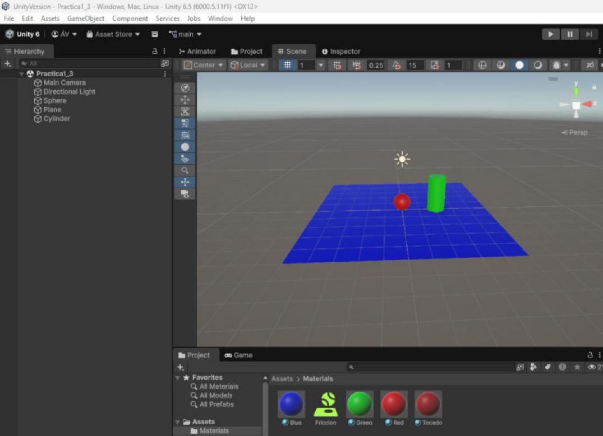

*Figura 11. La escena en /main, sin la cápsula ni su material.*

## Herramientas

Unity 6000.5.11f1 (URP) · Unity Version Control (paquete del editor `com.unity.collab-proxy` 2.13.6)

## Referencias

- Guion de la práctica y material de la asignatura (campus virtual de la ULL).
- Unity Technologies, [Use UVCS with the Unity Editor](https://docs.unity.com/en-us/unity-version-control/vcs-plugins/unityeditor-plugin/landing) (documentación oficial).
- Textura `URP.png`: plantilla `com.unity.template.urp-blank` 17.0.14, Unity Technologies ApS, [Unity Companion License](https://unity.com/legal/licenses/unity-companion-license).
