# Ejercicios de físicas 3D

**Fundamentos del Desarrollo de Videojuegos** · Máster Universitario en Desarrollo de Videojuegos · Universidad de La Laguna · Curso 2026-27
**Autor:** Ángel Gonjar Verdejo

## Objetivo

Experimentar con las configuraciones de Rigidbody y Collider de Unity y programar objetos que se mueven con físicas.

El proyecto Unity, `UnityVersion` (Unity 6000.5.11f1), se gestiona con Unity Version Control: rama `/main` del repositorio `My project/UnityVersion` (organización `agv114`), changesets 2 a 9 (28-oct-2026). Esta carpeta contiene el informe, las figuras (`img/`) y los scripts de los ejercicios 2 a 4 (`Scripts/`).

## Requisitos y evidencias

| # | Requisito (del enunciado) | Estado | Evidencia |
|---|---|---|---|
| 1 | Ejercicio 1: configurar las situaciones 1 a 9 con Rigidbody y Collider y explicar los resultados | ✅ | [Ejercicio 1](#ejercicio-1), figuras 1 a 9 y 4b |
| 2 | Ejercicio 2: controlar el cilindro con físicas mediante las flechas | ✅ | [`SphereController.cs`](Scripts/SphereController.cs), figura 10 |
| 3 | Ejercicio 3: varios objetos con Rigidbody dinámico que muestran por consola el nombre del objeto con el que colisionan y le cambian el color | ✅ | [`Ejercicio3Collision.cs`](Scripts/Ejercicio3Collision.cs), figuras 11 y 12 |
| 4 | Ejercicio 4: la esfera se dirige al cilindro; al alcanzar el cubo, este cambia de material y avanza hacia adelante | ✅ | [`Ejercicio4SphereController.cs`](Scripts/Ejercicio4SphereController.cs), [`Ejercicio4Cube.cs`](Scripts/Ejercicio4Cube.cs), figura 13 |

## Ejercicio 1

Las situaciones se configuran en la escena `SampleScene` a partir de la disposición del enunciado: un plano y la cámara en sus posiciones por defecto, un cubo en `(0, 0.5, 0)`, apoyado en el plano, y una esfera en `(0.64, 1.79, -0.36)`, según el Transform que muestra el enunciado. La esfera queda por encima del cubo, pero desplazada respecto a su centro.

Cada objeto conserva su collider por defecto: `MeshCollider` en el plano, `BoxCollider` en el cubo y `SphereCollider` en la esfera. Todas las masas valen 1 salvo que se indique otra, y la gravedad es la del proyecto, `(0, -9.81, 0)`.

El enunciado repite la numeración de algunas situaciones: hay dos «Situación 3», dos «Situación 5» y dos «Situación 6». En este informe se numeran del 1 al 9 en el orden en que aparecen.

| Situación | En el enunciado | Plano | Cubo | Esfera |
|:---:|---|---|---|---|
| 1 | Situación 1 | Solo collider | Rigidbody | Solo collider |
| 2 | Situación 2 | Solo collider | Rigidbody | Rigidbody |
| 3 | Situación 3 (primera) | Solo collider | Rigidbody | Rigidbody cinemático |
| 4 | Situación 3 (segunda) | Rigidbody | Rigidbody | Rigidbody |
| 5 | Situación 4 | Rigidbody | Rigidbody | Rigidbody, masa 10 |
| 6 | Situación 5 (primera) | Rigidbody | Rigidbody | Rigidbody, masa 100 |
| 7 | Situación 5 (segunda) | Rigidbody cinemático | Rigidbody | Rigidbody y Physics Material `Friccion` |
| 8 | Situación 6 (primera) | Rigidbody cinemático | Rigidbody | Rigidbody cinemático, *Is Trigger* |
| 9 | Situación 6 (segunda) | Rigidbody cinemático | Rigidbody | Rigidbody, *Is Trigger* |

«Rigidbody», sin más, indica un Rigidbody dinámico: un objeto físico, con *Is Kinematic* desactivado.

### Situación 1

**Configuración:** plano y esfera solo con collider; cubo con Rigidbody.

**Resultado:** ningún objeto se mueve. La esfera permanece en el aire y el cubo sigue apoyado en el plano (figura 1).

**Explicación:**

- Un objeto sin Rigidbody es un collider estático: los demás objetos chocan con él, pero el motor de físicas no lo mueve. Por eso la esfera no cae y el plano no se desplaza.
- El cubo sí está sometido a la gravedad, pero descansa sobre el collider del plano, que lo sostiene.
- Si el cubo se elevara, caería hasta el plano; si se colocara fuera de él, caería indefinidamente.

*Figura 1. Situación 1: solo el cubo tiene Rigidbody y ningún objeto se mueve.*

### Situación 2

**Configuración:** plano solo con collider; cubo y esfera con Rigidbody.

**Resultado:** la esfera cae, golpea la arista superior del cubo, se desvía hacia un lado y rueda por el plano hasta salir del encuadre. El cubo no se desplaza de forma apreciable (figura 2).

**Explicación:**

- La gravedad actúa sobre la esfera porque tiene Rigidbody.
- El centro de la esfera está en x = 0,64 y la cara del cubo termina en x = 0,5. Al quedar 0,14 m por fuera, el primer contacto se produce con la arista y no con la cara superior.
- En el choque con una arista, la fuerza de contacto sigue la línea que une el punto de contacto con el centro de la esfera. Esa fuerza es oblicua, y su componente horizontal empuja la esfera hacia un lado.
- Como pasa por el centro de la esfera, esa fuerza no la hace girar. El giro lo produce el rozamiento en los puntos de contacto, y por eso la esfera acaba rodando por el plano.
- No hay rebote. Sin Physics Material, la elasticidad (*Bounciness*) vale 0, así que la esfera no sale despedida hacia arriba al tocar el plano.
- El golpe sobre el cubo es casi vertical: lo aprieta contra el plano, y el rozamiento con este impide que se deslice.

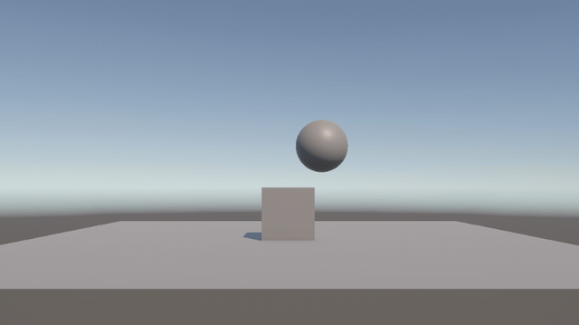

*Figura 2. Situación 2: la esfera cae, choca con la arista del cubo y rueda por el plano.*

### Situación 3

**Configuración:** plano solo con collider; cubo con Rigidbody; esfera con Rigidbody cinemático (*Is Kinematic*).

**Resultado:** ningún objeto se mueve; la esfera permanece en el aire (figura 3).

**Explicación:**

- Un Rigidbody cinemático no responde a la gravedad ni a las fuerzas. Solo se mueve si se cambia su Transform o con `Rigidbody.MovePosition`.
- El motor de físicas sí lo tiene en cuenta: si se moviera, empujaría a los objetos dinámicos con los que chocara, pero él no recibiría fuerzas de ellos.
- El cubo sigue apoyado en el plano, como en la situación 1.

*Figura 3. Situación 3: la esfera cinemática se queda en el aire.*

### Situación 4

**Configuración:** plano, cubo y esfera con Rigidbody. El plano conserva su `MeshCollider`, que no es convexo.

**Resultado:** los tres objetos caen a la vez y salen del encuadre; la esfera no llega a tocar el cubo (figura 4). Al iniciar la ejecución, la consola muestra el error «Concave Mesh Colliders are not supported when used with dynamic Rigidbody GameObjects. Either make the Mesh Collider convex, or make the Rigidbody kinematic.» (figura 4b).

**Explicación:**

- El plano también tiene un Rigidbody dinámico. La gravedad actúa sobre él y nada lo sostiene, de modo que cae junto con el cubo y la esfera.
- Los tres parten del reposo y caen con la misma aceleración, 9,81 m/s². No hay resistencia del aire (*Linear Damping* vale 0), así que conservan su separación y la esfera nunca alcanza al cubo.
- El error se debe al collider del plano. Un `MeshCollider` no convexo es una malla de triángulos sin volumen interior. PhysX, el motor de físicas de Unity, solo lo admite en objetos estáticos o cinemáticos: en un cuerpo dinámico no puede calcular su masa e inercia ni resolver de forma fiable sus choques.
- El mensaje indica las dos soluciones: marcar *Convex* en el `MeshCollider` o hacer cinemático el Rigidbody, como en las situaciones 7 a 9. Con *Convex*, el resultado visible sería el mismo, porque los tres objetos seguirían cayendo juntos.

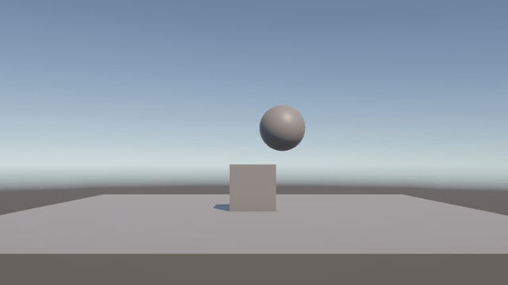

*Figura 4. Situación 4: el plano, el cubo y la esfera caen a la vez.*

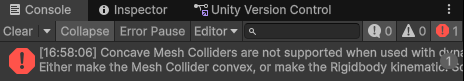

*Figura 4b. Error de la consola en la situación 4: MeshCollider no convexo con Rigidbody dinámico.*

### Situación 5

**Configuración:** como la situación 4, con la esfera 10 veces más pesada que el cubo (masa 10 frente a 1).

**Resultado:** el mismo que en la situación 4: los tres objetos caen juntos y la esfera no alcanza al cubo (figura 5).

**Explicación:**

- En caída libre, la masa no cambia la aceleración. El peso es proporcional a la masa (P = m · g), así que la aceleración vale g para cualquier masa.
- La masa solo influiría en un choque entre los objetos, y aquí no se produce porque todos caen a la vez.
- El plano tiene la misma configuración que en la situación 4, así que se produce el mismo error del `MeshCollider`.

*Figura 5. Situación 5: con la esfera 10 veces más pesada, todo cae igual.*

### Situación 6

**Configuración:** como la situación 4, con la esfera 100 veces más pesada que el cubo (masa 100).

**Resultado:** idéntico al de las situaciones 4 y 5 (figura 6).

**Explicación:** la misma que en la situación 5. Multiplicar la masa por 100 no cambia la aceleración de caída, y los objetos no llegan a chocar entre sí.

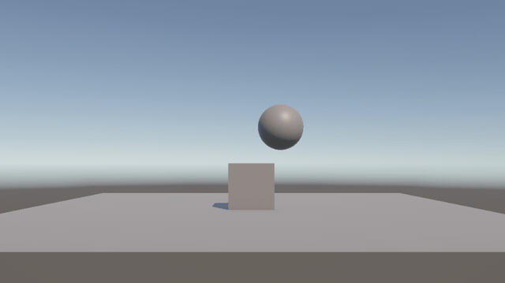

*Figura 6. Situación 6: con la esfera 100 veces más pesada, todo cae igual.*

### Situación 7

**Configuración:** plano con Rigidbody cinemático; cubo con Rigidbody; esfera con Rigidbody y, en su collider, el Physics Material `Friccion`: *Dynamic Friction* y *Static Friction* de 1, *Bounciness* de 0 y *Friction Combine* en *Maximum*.

**Resultado:** el plano no se mueve. La esfera cae, golpea la arista del cubo y rueda por el plano hasta salir del encuadre, de forma parecida a la situación 2 (figura 7).

**Explicación:**

- Al ser cinemático, el plano no responde a la gravedad ni a los impactos: permanece inmóvil y sostiene al cubo y a la esfera. Un `MeshCollider` no convexo sí está permitido en un Rigidbody cinemático, así que esta configuración no produce el error de la situación 4.
- Un Physics Material define el rozamiento entre superficies. *Static Friction* se opone a que empiecen a deslizar, y *Dynamic Friction*, a que sigan deslizando.
- Con *Friction Combine* en *Maximum*, en cada contacto se usa el mayor de los dos valores, aquí 1. Sin Physics Material, Unity usa 0,6.
- Cuando la esfera llega al plano, el rozamiento frena su deslizamiento y lo convierte en rodadura.
- Una vez que la esfera rueda sin deslizar, el valor del rozamiento casi no influye; por eso el resultado se parece al de la situación 2. Durante la rodadura, la esfera pierde velocidad por el *Angular Damping* de su Rigidbody (0,05).

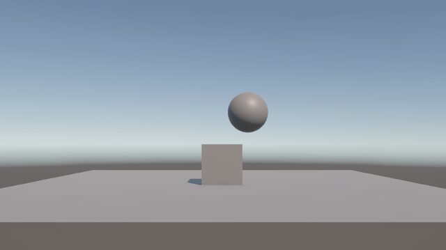

*Figura 7. Situación 7: plano cinemático y esfera con fricción; la esfera rueda tras el choque.*

### Situación 8

**Configuración:** plano con Rigidbody cinemático; cubo con Rigidbody; esfera con Rigidbody cinemático e *Is Trigger* activado en su collider. El enunciado pide a la vez que la esfera no sea física y que todos los objetos tengan Rigidbody; por eso su Rigidbody es cinemático.

**Resultado:** ningún objeto se mueve (figura 8).

**Explicación:**

- La esfera es cinemática, así que no cae.
- *Is Trigger* hace que su collider no produzca choques físicos: los objetos lo atraviesan y solo se lanzan los eventos `OnTriggerEnter`, `OnTriggerStay` y `OnTriggerExit`.
- Como la esfera no se mueve ni toca ningún objeto, no ocurre nada.

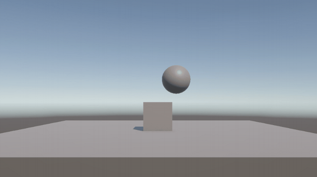

*Figura 8. Situación 8: esfera cinemática y trigger; ningún objeto se mueve.*

### Situación 9

**Configuración:** plano con Rigidbody cinemático; cubo con Rigidbody; esfera con Rigidbody e *Is Trigger*.

**Resultado:** la esfera cae, atraviesa el cubo y el plano y sigue cayendo fuera del encuadre. El cubo permanece sobre el plano (figura 9).

**Explicación:**

- La esfera es dinámica, así que la gravedad la hace caer.
- Al ser trigger, su collider detecta los solapamientos, pero no produce fuerzas de contacto. Nada la frena: atraviesa el cubo y el plano y cae indefinidamente.
- El cubo tiene un collider normal: choca con el plano y se queda sobre él.

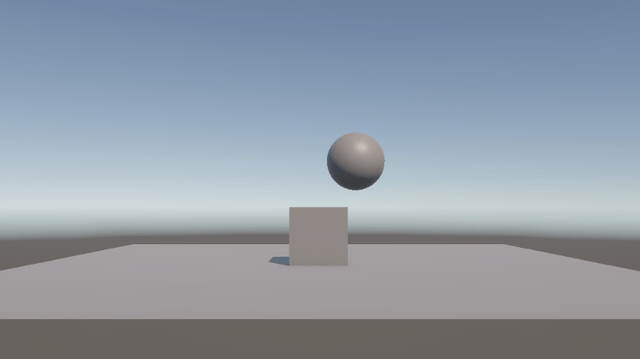

*Figura 9. Situación 9: la esfera trigger atraviesa el cubo y el plano.*

## Ejercicio 2

**Enunciado:** crear un controlador que mueva el cilindro con físicas mediante las flechas arriba, abajo, derecha e izquierda.

**Escena:** `Ejercicio2.unity`. Contiene el plano y el cilindro `Cylinder` en `(0, 1, 0)`, con `CapsuleCollider` y Rigidbody dinámico de masa 1. En el Rigidbody están marcadas *Freeze Rotation X* y *Z*: el collider del cilindro es una cápsula, de base redondeada, y sin esas restricciones podría volcar al empujarlo.

**Script:** [`SphereController.cs`](Scripts/SphereController.cs), en el cilindro, con `force = 10`.

- En `Update` lee los ejes `Horizontal` y `Vertical` con `Input.GetAxis`. En el Input Manager del proyecto, `Horizontal` usa las flechas izquierda y derecha y las teclas A y D; `Vertical`, las flechas arriba y abajo y las teclas W y S.
- Con ellos forma la dirección `(h, 0, v)`. El cilindro se desplaza sobre el plano horizontal XZ: la entrada arriba/abajo se asigna al eje Z y la componente Y vale 0. Si el vector mide más de 1, se normaliza para que en diagonal no empuje más.
- Aplica `rb.AddForce(direction * force)` en `FixedUpdate`, que Unity llama con el paso fijo de la física (*Fixed Timestep* del proyecto: 0,02 s). La fuerza no se multiplica por `Time.deltaTime`: el motor la aplica durante todo el paso y calcula él mismo el cambio de velocidad.
- Para usar la clase `Input` junto al paquete Input System, el proyecto tiene *Active Input Handling* en *Both*.

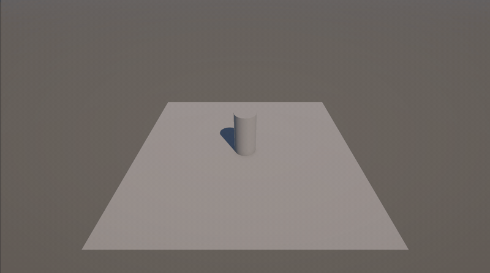

*Figura 10. Cilindro movido con las flechas en la escena Ejercicio2.*

## Ejercicio 3

**Enunciado:** crear varios cubos o esferas con Rigidbody dinámico, mostrar por consola el nombre del objeto con el que colisionan y cambiarle el color al colisionar.

**Escena:** `Ejercicio3.unity`. Sobre el plano hay cinco objetos con Rigidbody dinámico. Los cubos `Cube1`, `Cube2` y `Cube3` están en columna, a 2, 4 y 6 m de altura, en torno a x = -2. Las esferas `Sphere1` y `Sphere2` están a 3 y 5 m, en torno a x = 1,6. Al caer chocan con el plano y entre sí.

**Script:** [`Ejercicio3Collision.cs`](Scripts/Ejercicio3Collision.cs), en los cinco objetos, con el material `Tocado` (rojo) asignado en `nuevoMaterial`.

- `OnCollisionEnter(Collision other)` se ejecuta al comenzar cada contacto. Asigna `nuevoMaterial` al `Renderer` del otro objeto (`other.gameObject`), que pasa a verse rojo.
- Guarda el nombre del otro objeto en `mensaje` y lo escribe en la consola con `Debug.Log`.
- `OnGUI` muestra además ese nombre en la esquina superior izquierda de la pantalla.

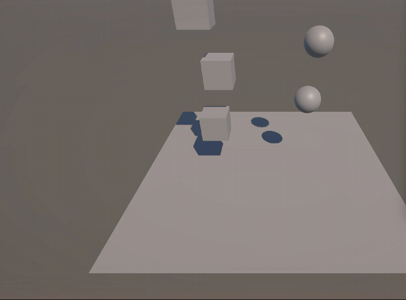

*Figura 11. Los objetos cambian al material Tocado al chocar.*

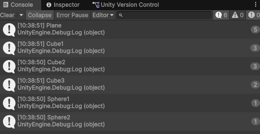

*Figura 12. Consola con el nombre de cada objeto con el que se colisiona.*

## Ejercicio 4

**Enunciado:** escena con un cubo y un cilindro cinemáticos y una esfera con collider y Rigidbody. El cilindro es el objetivo de la esfera y el cubo hace de obstáculo entre ambos. La esfera se dirige al cilindro y, cuando alcanza el cubo, este cambia de material y avanza hacia adelante.

**Escena:** `Ejercicio4.unity`. Los tres objetos están alineados en el eje X: la esfera, dinámica, en `(-4, 0.5, 0)`; el cubo, cinemático, en `(0, 0.5, 0)`; y el cilindro, cinemático, en `(4, 1, 0)`.

**Scripts:**

- [`Ejercicio4SphereController.cs`](Scripts/Ejercicio4SphereController.cs), en la esfera, con el cilindro en `target` y `force = 4`. En `Update` calcula la dirección hacia el objetivo: la posición del cilindro menos la de la esfera. En `FixedUpdate`, mientras la distancia al cilindro (`direction.magnitude`) sea mayor que `accuracy` (0,01 en la escena), aplica `rb.AddForce(direction.normalized * force)`. Al normalizar la dirección, la fuerza vale siempre 4 N, sea cual sea la distancia.
- [`Ejercicio4Cube.cs`](Scripts/Ejercicio4Cube.cs), en el cubo, con `Tocado` en `nuevoMaterial` y `speed = 4`. En `OnCollisionEnter` cambia su propio material a `Tocado` y activa la variable `moving`. Ese evento solo llega con el choque de la esfera, porque entre un Rigidbody cinemático y objetos estáticos o cinemáticos no se generan eventos de colisión.
- Al ser cinemático, el cubo no responde a fuerzas ni a la gravedad: su posición se cambia desde el script. Cuando `moving` está activa, `FixedUpdate` lo desplaza con `transform.Translate(Vector3.forward * speed * Time.deltaTime)`. Sin el parámetro `Space`, `Translate` usa los ejes locales del cubo, así que `Vector3.forward` es la dirección hacia la que mira (+Z con su rotación de la escena). Dentro de `FixedUpdate`, `Time.deltaTime` devuelve el paso fijo de la física.
- El avance continúa mientras la distancia del cubo al cilindro sea mayor que `accuracy`. Como el cubo se aleja del cilindro, la condición se sigue cumpliendo y el cubo continúa hacia adelante hasta salir del plano (figura 13).

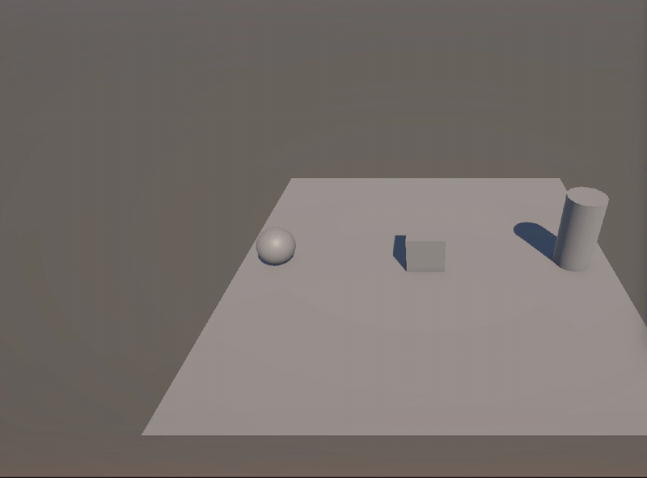

*Figura 13. La esfera se dirige al cilindro; al chocar con el cubo, este cambia de material y avanza.*

## Herramientas

Unity 6 (6000.5.11f1, Universal Render Pipeline) · C# · Unity Version Control

## Referencias

- Enunciado «Ejercicios Físicas 3D» y material de la asignatura (campus virtual de la ULL).
- Documentación de Unity 6 (docs.unity3d.com): Rigidbody, Mesh Collider, Physics Material, `Rigidbody.AddForce`, `Rigidbody.MovePosition`, `Transform.Translate`, `Time.deltaTime` y `OnCollisionEnter`.
