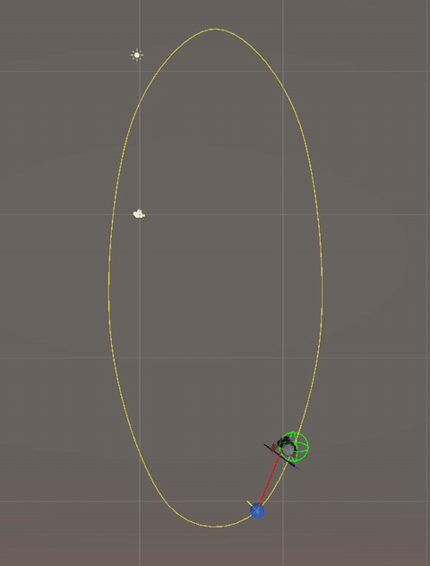
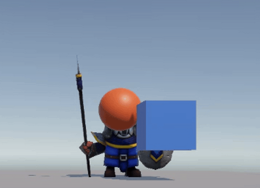
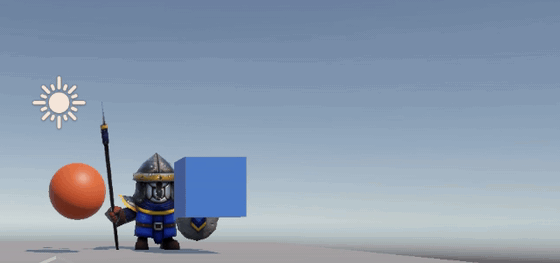
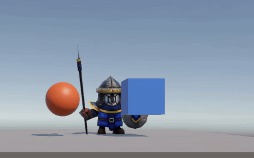
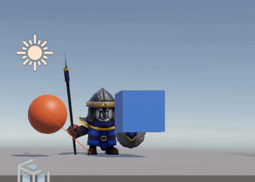
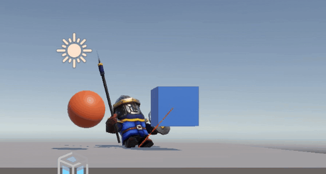
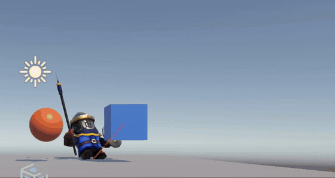
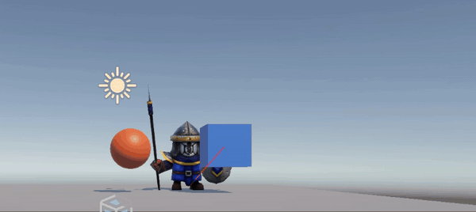
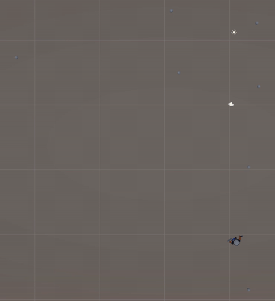

# Scripts: movimiento rectilíneo 1

**Fundamentos del Desarrollo de Videojuegos** · Máster Universitario en Desarrollo de Videojuegos · Universidad de La Laguna · Curso 2026-27
**Autor:** Ángel Gonjar Verdejo

## Objetivo

Resolver en Unity los ejercicios de movimiento rectilíneo del guion del tema 2. Se usan `Translate`, `normalized`, `Time.deltaTime`, `LookAt`, `MoveTowards`, `Quaternion.Slerp` y *waypoints*.

El proyecto Unity, `fdf-perforce` (Unity 6000.5.11f1), está en el depósito Perforce `//FDV2627/angel/`: changelists 1592 a 1596 (28-oct-2026). Esta carpeta contiene el informe, los GIF de la ejecución (`img/`) y una copia de los scripts (`Scripts/`).

## Demo

*Figura 1. Ejercicio 11: `FootmanPolyart` recorre el circuito tras el objeto `Target`, que mueve `WaypointProgressTracker`.*

## Requisitos y evidencias

| Ej. | Qué pide el guion | Estado | Evidencia |
|:---:|---|:---:|---|
| 1 | Mover el objeto hacia un objetivo público con `Translate`; probar `goal * 0.5f`, `goal * 2.0f`, Y = 0 e Y ≠ 0 | ✅ | [`Ejercicio1.cs`](Scripts/Ejercicio1.cs) · figura 2 |
| 1.d | Modificar el script para que el objeto despegue y vuele como un avión | ✅ | [`Ejercicio1d.cs`](Scripts/Ejercicio1d.cs) · figura 3 |
| 2 | Movimiento consistente con `normalized`, una velocidad `speed` y `Time.deltaTime` | ✅ | [`Ejercicio2.cs`](Scripts/Ejercicio2.cs) · figura 4 |
| 3 | Moverse hacia una posición: `LookAt`, dirección hacia el objetivo y `Translate` en `Space.World` | ✅ | [`Ejercicio3.cs`](Scripts/Ejercicio3.cs) · figura 5 |
| 4 | Comprobar la dirección con `Debug.DrawRay` | ✅ | [`Ejercicio3.cs`](Scripts/Ejercicio3.cs) · figura 5 |
| 5 | Cubo movido con las flechas y personaje que lo sigue sin físicas; velocidad pública; la barra espaciadora la aumenta | ✅ | [`Player.cs`](Scripts/Player.cs) · [`Ejercicio5following.cs`](Scripts/Ejercicio5following.cs) · figura 6 |
| 6 | Rotar hacia el objetivo con `LookAt` y desplazarse sobre el vector *forward* local | ✅ | [`Ejercicio5following.cs`](Scripts/Ejercicio5following.cs) · figura 6 · [`Ejercicio11.cs`](Scripts/Ejercicio11.cs) · figura 1 |
| 7 | Evitar el *jittering* con la magnitud de la dirección, con la distancia y con `MoveTowards` | ✅ | Magnitud: [`Ejercicio11.cs`](Scripts/Ejercicio11.cs) · distancia: [`Ejercicio10.cs`](Scripts/Ejercicio10.cs) · `MoveTowards`: [`Ejercicio7c.cs`](Scripts/Ejercicio7c.cs) · figura 7 |
| 8 | Giro suave con `Quaternion.Slerp` | ✅ | [`Ejercicio8.cs`](Scripts/Ejercicio8.cs) · figura 8 |
| 10 | Circuito de puntos con la etiqueta «waypoint» y personaje que recupera sus referencias y lo recorre | ✅ | [`Ejercicio10.cs`](Scripts/Ejercicio10.cs) · figura 9 |
| 11 | Sistema de *waypoints* de Unity | ✅ | [`Ejercicio11.cs`](Scripts/Ejercicio11.cs) · figura 1 |

La numeración es la del guion, con los apartados en letras (1.d, 7.a…). No hay ejercicio 9: en el guion, ese número lo ocupa la firma de `Quaternion.Slerp` del ejercicio 8.

## Scripts y escenas

| Script | Ej. | Escena · objeto | Valores en el Inspector |
|---|:---:|---|---|
| [`Ejercicio1.cs`](Scripts/Ejercicio1.cs) | 1 | `SampleScene` · `Sphere` | `goal` = `GameObject`, en (1,5; 0,5; 1) |
| [`Ejercicio1d.cs`](Scripts/Ejercicio1d.cs) | 1.d | `SampleScene` · `Sphere` | `goal` = `GameObject` · `speed` = 2 · `runway` = 5 |
| [`Ejercicio2.cs`](Scripts/Ejercicio2.cs) | 2 | `SampleScene` · `Sphere` | `goal` = `GameObject` · `speed` = 1 |
| [`Ejercicio3.cs`](Scripts/Ejercicio3.cs) | 3 y 4 | `SampleScene` · `Sphere` | `goal` = `GameObject` · `speed` = 4 |
| [`Player.cs`](Scripts/Player.cs) | 5 | `SampleScene` · `Cube` | `initSpeed` = 10 · `a` = 2 · `speed` = 8 |
| [`Ejercicio5following.cs`](Scripts/Ejercicio5following.cs) | 5 | `SampleScene` · `FootmanPBR` | `player` = `Cube` · `speed` = 6 · `accuracy` = 0,01 |
| [`Ejercicio7c.cs`](Scripts/Ejercicio7c.cs) | 7.c | `SampleScene` · `FootmanPBR` | `target` = `Cube` · `speed` = 2 |
| [`Ejercicio8.cs`](Scripts/Ejercicio8.cs) | 8 | `SampleScene` · `FootmanPBR` | `target` = `Cube` · `speed` = 2 · `rotSpeed` = 2 · `accuracy` = 1 |
| [`Ejercicio10.cs`](Scripts/Ejercicio10.cs) | 7.b y 10 | `Ejercicio10` · `FootmanPolyart` | `speed` = 8 · `accuracy` = 1 |
| [`Ejercicio11.cs`](Scripts/Ejercicio11.cs) | 6, 7.a y 11 | `Ejercicio11` · `FootmanPolyart` | `target` = `Target` · `speed` = 8 · `accuracy` = 0,01 |

En `SampleScene`, la esfera lleva los componentes de los ejercicios 1, 1.d, 2 y 3. `FootmanPBR` lleva los de los ejercicios 5, 7.c y 8. En cada ejecución se activa uno solo por objeto. En la escena guardada están activos los del ejercicio 5.

## Ejercicio 1 · Translate hacia un objetivo

- `Ejercicio1.cs` guarda en `Start` la posición del objeto `goal` en el vector `target`. En cada `Update` aplica `transform.Translate(target)` y reduce `target` a la mitad.
- El argumento de `Translate` se suma a la posición actual: indica cuánto se mueve el objeto, no a qué punto llega. Sin segundo parámetro, se interpreta en los ejes locales (`Space.Self`).
- La posición de `goal` funciona como un vector desde el origen del mundo: la esfera no termina sobre el objeto `goal`.
- Los desplazamientos forman una serie geométrica de razón 1/2 (`target`, `target/2`, `target/4`…) cuya suma es el doble del vector inicial. En pocos frames, la esfera queda casi quieta: se ha desplazado esa suma desde su punto de partida.

En el guion, `goal` es el vector; en `Ejercicio1.cs` ese vector se llama `target`.

| Variante del guion | Resultado |
|---|---|
| `Translate(goal)` solo en `Start` | El objeto se traslada `goal` una vez: Unity llama a `Start` una sola vez, antes del primer `Update` |
| 1.a: `goal = goal * 0.5f` en `Update` (el script) | Cada paso mide la mitad que el anterior; el objeto se detiene a 2·`goal` de su posición inicial |
| 1.a: `goal = goal * 0.5f` en `Start` y `Translate(goal)` en `Update` | `goal` se divide entre dos una sola vez, en `Start`, y ya no cambia: el objeto avanza `goal/2` en cada frame, sin límite |
| 1.a: `goal = goal * 2.0f` en `Update` | La longitud del paso se duplica en cada frame (crecimiento exponencial): el objeto abandona el encuadre casi de inmediato |
| 1.b: objetivo con Y = 0 | El desplazamiento no tiene componente vertical: el objeto se mueve en paralelo al suelo |
| 1.c: objetivo con Y ≠ 0 | El objeto también sube (Y > 0) o baja (Y < 0); al moverse con `Translate` y sin `Rigidbody`, nada le impide atravesar el plano |

*Figura 2. Ejercicio 1: desplazamientos sucesivos de la esfera con `goal * 0.5f`, grabados frame a frame con el botón Step del editor.*

### 1.d · Despegue como un avión

- `Ejercicio1d.cs` es la modificación del ejercicio 1, en un script aparte para conservar el código del apartado 1.a.
- En `Start` guarda la posición de `goal` y la posición inicial del objeto.
- Mientras la distancia recorrida no supera `runway`, anula la componente Y de la dirección, como en 1.b: el objeto avanza en horizontal, como un avión por la pista.
- Después usa la dirección completa de `goal`, cuya Y es mayor que 0, como en 1.c: el objeto gana altura sin parar.
- Se orienta con `LookAt` hacia donde avanza. Por eso traslada en `Space.World`, igual que el ejercicio 3.
- Avanza a `speed` unidades por segundo con `normalized` y `Time.deltaTime` (ejercicio 2). Con el `Translate(goal)` por frame del ejercicio 1 saldría del encuadre casi al instante.
- Para que despegue, `goal` necesita una Y mayor que 0. Si su X y su Z valen 0, no avanza por la pista.

*Figura 3. Apartado 1.d: la esfera avanza 5 unidades sin subir y después gana altura.*

## Ejercicio 2 · Movimiento consistente

- `Ejercicio2.cs` normaliza en `Start` la posición del objeto `goal`. El vector normalizado conserva la dirección y mide 1: su longitud deja de influir en el paso.
- En cada `Update` traslada el objeto `target * speed * Time.deltaTime`.
- `Time.deltaTime` es el tiempo, en segundos, transcurrido desde el frame anterior. Al multiplicar por él, `speed` se expresa en unidades por segundo.
- Sin `deltaTime`, el paso sería fijo por frame y el objeto iría más rápido en un equipo con más FPS (frames por segundo).
- El guion propone `speed = 0.1f`, pensado para un paso por frame. Con `deltaTime` serían 0,1 unidades por segundo, así que en la escena vale 1.

*Figura 4. Ejercicio 2: avance con la dirección normalizada, `speed` y `Time.deltaTime`.*

## Ejercicios 3 y 4 · Movimiento hacia una posición

- `Ejercicio3.cs` recibe el objetivo como `Transform`. En `Start`, `LookAt` orienta hacia él el eje Z local (*forward*) del objeto.
- En cada `Update` calcula la dirección como destino menos origen: `goal.position - transform.position`.
- Traslada `direction.normalized * speed * Time.deltaTime` con `Space.World`. `direction` se calcula en el sistema de referencia del mundo, que deja de coincidir con el del objeto después del `LookAt`.
- Ejercicio 4: `Debug.DrawRay(transform.position, direction, Color.red)` traza en cada frame un segmento rojo desde el objeto hacia el objetivo. Aparece en la vista *Scene* y, si los *Gizmos* están activados, también en la vista *Game*.
- El script no tiene tolerancia de llegada: al alcanzar el objetivo, el objeto oscila sobre él (ejercicio 7), aunque en la figura 5 no se aprecia.

*Figura 5. Ejercicios 3 y 4: avance hacia el objetivo en `Space.World` y rayo de `Debug.DrawRay`.*

## Ejercicio 5 · Cubo con flechas y personaje que lo sigue

- `Player.cs`, en el objeto `Cube`, lee `Input.GetAxis("Horizontal")` e `Input.GetAxis("Vertical")`: flechas, o A/D y W/S, según el *Input Manager* del proyecto.
- El proyecto tiene *Active Input Handling* en *Both*, así que la clase `Input` funciona junto al paquete Input System.
- Con esos ejes forma el vector (x, y, 0) y lo normaliza si mide más de 1. Después traslada el cubo en `Space.World` a `speed` unidades por segundo.
- El vector usa X e Y. Las flechas izquierda y derecha mueven el cubo en horizontal; las de arriba y abajo lo suben y lo bajan.
- Al pulsar la barra espaciadora, `speed` pasa a valer `initSpeed · a`: 20 con los valores de la escena, frente a 8 al empezar. No hay nada que la devuelva a 8, así que el cubo sigue a 20 aunque se suelte la tecla.
- El guion no concreta qué velocidad aumenta la barra espaciadora (5.c); aquí aumenta la del cubo.
- `Ejercicio5following.cs`, en el personaje `FootmanPBR`, recibe el cubo en el campo público `player`. Su velocidad, `speed`, también es pública y se gradúa desde el Inspector.
- En cada `Update`, si la distancia al cubo supera `accuracy`, el personaje gira hacia él con `LookAt` y avanza por su eje *forward* local. Al estar el cubo por encima del suelo, el personaje se inclina y sube hacia su centro.
- Ninguno de los dos scripts usa físicas: ambos objetos se desplazan con `Translate`.

*Figura 6. Ejercicio 5: `FootmanPBR` persigue al cubo, que se mueve con las flechas.*

## Ejercicio 6 · Avance por el eje forward local

- El guion lo plantea como alternativa al ejercicio 5, pero `Ejercicio5following.cs` ya usa esta técnica: `LookAt` y `Translate(Vector3.forward * speed * Time.deltaTime)`.
- El parámetro `relativeTo` de `Translate` vale `Space.Self` por defecto. Por eso `Vector3.forward` se interpreta como el eje Z local del personaje, que el `LookAt` acaba de orientar hacia el objetivo. Con `Space.World`, sería el eje Z del mundo.
- `Ejercicio11.cs` también la aplica para perseguir al objeto `Target` (figura 1).

## Ejercicio 7 · Control del jittering

- En el último paso, `speed · Time.deltaTime` suele superar la distancia que falta. El personaje se pasa, `LookAt` lo gira 180° y vuelve, frame tras frame: es el *jittering*.
- Con la magnitud (7.a): `Ejercicio11.cs` solo avanza si `direction.magnitude > accuracy`.
- Con la distancia (7.b): `Ejercicio10.cs` da por alcanzado un *waypoint* cuando `Vector3.Distance` es menor que `accuracy`. `Vector3.Distance(a, b)` equivale a `(a - b).magnitude`.
- La tolerancia no basta si la velocidad es alta. La parada solo está garantizada si el paso de un frame no supera 2·`accuracy`, el ancho de la zona de parada.
- Con los valores de `Ejercicio11` (`speed` = 8, `accuracy` = 0,01) no se cumple por debajo de 400 FPS. No se nota porque `Target` va unas 5 unidades por delante.
- Con `Vector3.MoveTowards` (7.c): `Ejercicio7c.cs` asigna a `transform.position` el resultado de `MoveTowards(posición, destino, speed * Time.deltaTime)`. Si el paso es mayor que lo que falta, devuelve justo el destino, así que no hace falta `accuracy`.
- Antes de moverse gira hacia el cubo con `LookAt`, salvo cuando ya está en su posición.

*Figura 7. Apartado 7.c: `FootmanPBR` llega a la posición del cubo y se detiene en ella; al mover el cubo, vuelve a hacerlo.*

## Ejercicio 8 · Giro suave con Quaternion.Slerp

- El guion escribe `Quaternion.Slerp(Vector3 from, Vector3 to, float t)`, pero `Quaternion.Slerp` recibe dos `Quaternion` y `t`.
- `Ejercicio8.cs` obtiene la rotación que mira hacia el cubo con `Quaternion.LookRotation(direction)`.
- En cada frame aplica `Quaternion.Slerp(rotación actual, rotación final, rotSpeed * Time.deltaTime)`. Así el giro se reparte entre varios frames en lugar de hacerse de golpe como con `LookAt`.
- Mientras gira, avanza por su eje *forward* local, como en el ejercicio 6.
- `accuracy` vale 1, no 0,01 como en el ejercicio 7 del guion. Como el giro es progresivo, con una tolerancia tan pequeña el personaje puede quedarse dando vueltas alrededor del objetivo sin alcanzarlo.

*Figura 8. Ejercicio 8: `FootmanPBR` gira de forma progresiva hacia el cubo cuando este cambia de sitio.*

## Ejercicio 10 · Sistema de waypoints propio

- La escena `Ejercicio10` tiene siete objetos vacíos, de `Waypoint0` a `Waypoint6`, con la etiqueta `waypoint`. Están a la misma altura que el personaje (Y = 0). El personaje `FootmanPolyart` lleva `Ejercicio10.cs`.
- El script no usa la etiqueta `waypoint`: en `Start` recupera los puntos por su nombre, `"Waypoint" + i`, hasta que falta uno. Los guarda en una lista y crea una esfera sin *collider* como hijo de cada punto, para que el circuito se vea al ejecutar.
- En `Update`, si el personaje está a menos de `accuracy` del punto actual, pasa al siguiente con `(current + 1) % waypoints.Count`. Después de `Waypoint6` regresa a `Waypoint0`: el circuito es cerrado.
- Para avanzar, gira hacia el punto con `LookAt` y se traslada en `Space.World` a `speed` unidades por segundo.

*Figura 9. Ejercicio 10: recorrido cerrado de `Waypoint0` a `Waypoint6`, con una esfera en cada punto.*

## Ejercicio 11 · Sistema de waypoints de Unity

- Se importó la carpeta `Utility`, recurso del campus «Sistema Waypoints de Unity», con los scripts `WaypointCircuit` y `WaypointProgressTracker`.
- En la escena `Ejercicio11`, el objeto `Parent` lleva `WaypointCircuit` con siete hijos vacíos, de `Waypoint1` a `Waypoint7`, y la ruta suavizada (*Smooth Route*).
- `Target` es el objeto que persigue el personaje: una instancia del prefab `CuboAzul` con malla de esfera, fuera de la jerarquía del personaje.
- `FootmanPolyart` lleva `WaypointProgressTracker`, con *Circuit* = `Parent`, *Target* = `Target` y el modo *Smooth Along Route*. También lleva `Ejercicio11.cs`, cuyo campo `target` apunta al mismo objeto `Target`.
- En cada frame, `WaypointProgressTracker` coloca `Target` sobre la ruta, por delante del punto que marca el progreso del personaje. La ventaja es de 5 unidades (*Look Ahead For Target Offset*) más 0,1 veces la velocidad del personaje.
- El progreso solo aumenta cuando el personaje rebasa ese punto: sin un script que mueva al personaje, `Target` no avanzaría.
- `Ejercicio11.cs` gira al personaje hacia `Target` con `LookAt` y lo hace avanzar por su eje *forward* local mientras la distancia supere `accuracy`. Así, personaje y objetivo recorren juntos el circuito (figura 1).
- Con la primera colocación de los puntos, la ruta tenía dos curvas en horquilla. El personaje se quedaba parado en la punta de la primera.
- En la horquilla alcanzaba a `Target` sin rebasar el punto de progreso, así que el progreso dejaba de aumentar.
- En una simulación del código, cambiar `speed`, `accuracy` o *Smooth Route* no lo resolvía.
- Los puntos se recolocaron en una elipse sobre la misma zona. El paso 2 del guion lo permite: «colocados donde quieras que pase el personaje».

## Herramientas

Unity 6 (6000.5.11f1, Universal Render Pipeline) · C# · Perforce (P4V)

## Referencias

- Guion de clase del tema 2, «Movimiento Rectilíneo-Eventos» (campus virtual de la ULL).
- Unity Technologies, `WaypointCircuit` y `WaypointProgressTracker` (*Standard Assets*, espacio de nombres `UnityStandardAssets.Utility`), facilitados en el campus como «Sistema Waypoints de Unity». La ficha de [Standard Assets](https://assetstore.unity.com/packages/essentials/asset-packs/standard-assets-for-unity-2018-4-32351) en la Unity Asset Store indica que el paquete está retirado y no muestra su licencia.
- Dungeon Mason, [*Mini Legion Footman PBR HP Polyart*](https://assetstore.unity.com/packages/3d/characters/humanoids/fantasy/mini-legion-footman-pbr-hp-polyart-86576) (Unity Asset Store, gratuito, Standard Unity Asset Store EULA), modelo del personaje.
- Documentación de Unity: [Transform.Translate](https://docs.unity3d.com/ScriptReference/Transform.Translate.html), [Transform.LookAt](https://docs.unity3d.com/ScriptReference/Transform.LookAt.html), [Vector3.normalized](https://docs.unity3d.com/ScriptReference/Vector3-normalized.html), [Time.deltaTime](https://docs.unity3d.com/ScriptReference/Time-deltaTime.html), [Debug.DrawRay](https://docs.unity3d.com/ScriptReference/Debug.DrawRay.html), [Vector3.Distance](https://docs.unity3d.com/ScriptReference/Vector3.Distance.html), [Vector3.MoveTowards](https://docs.unity3d.com/ScriptReference/Vector3.MoveTowards.html), [Quaternion.Slerp](https://docs.unity3d.com/ScriptReference/Quaternion.Slerp.html), [Quaternion.LookRotation](https://docs.unity3d.com/ScriptReference/Quaternion.LookRotation.html) e [Input.GetAxis](https://docs.unity3d.com/ScriptReference/Input.GetAxis.html).
